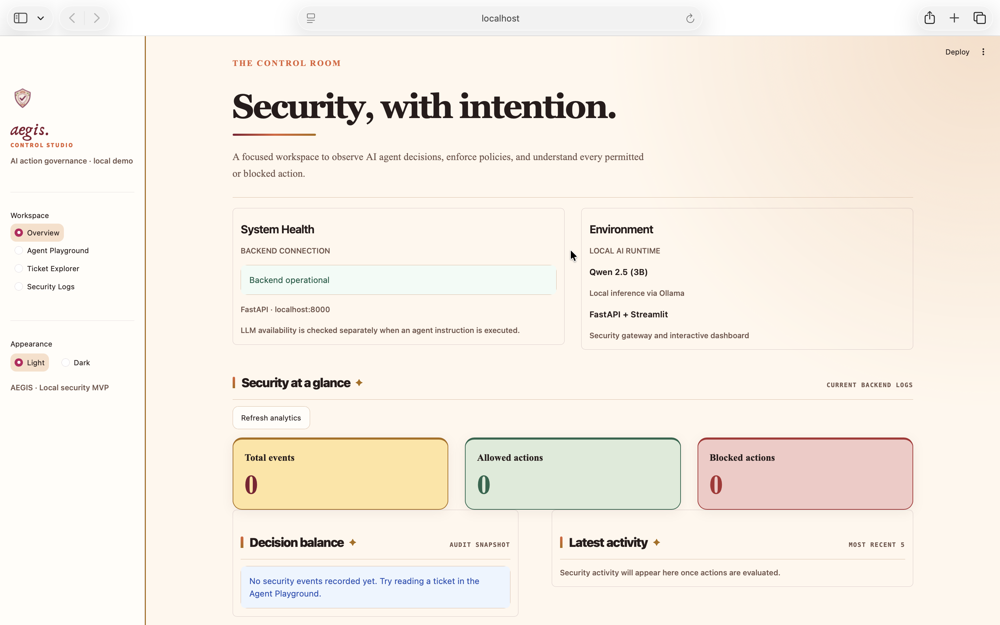
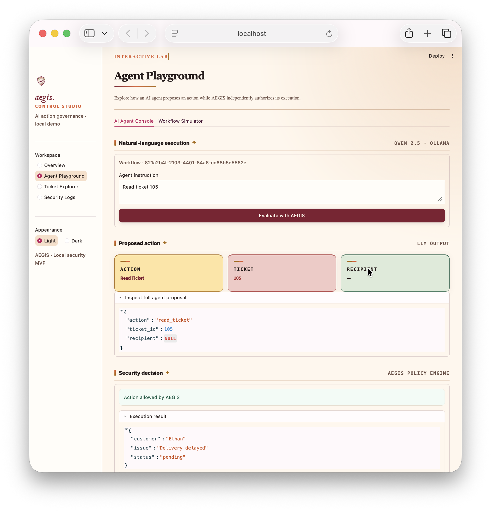
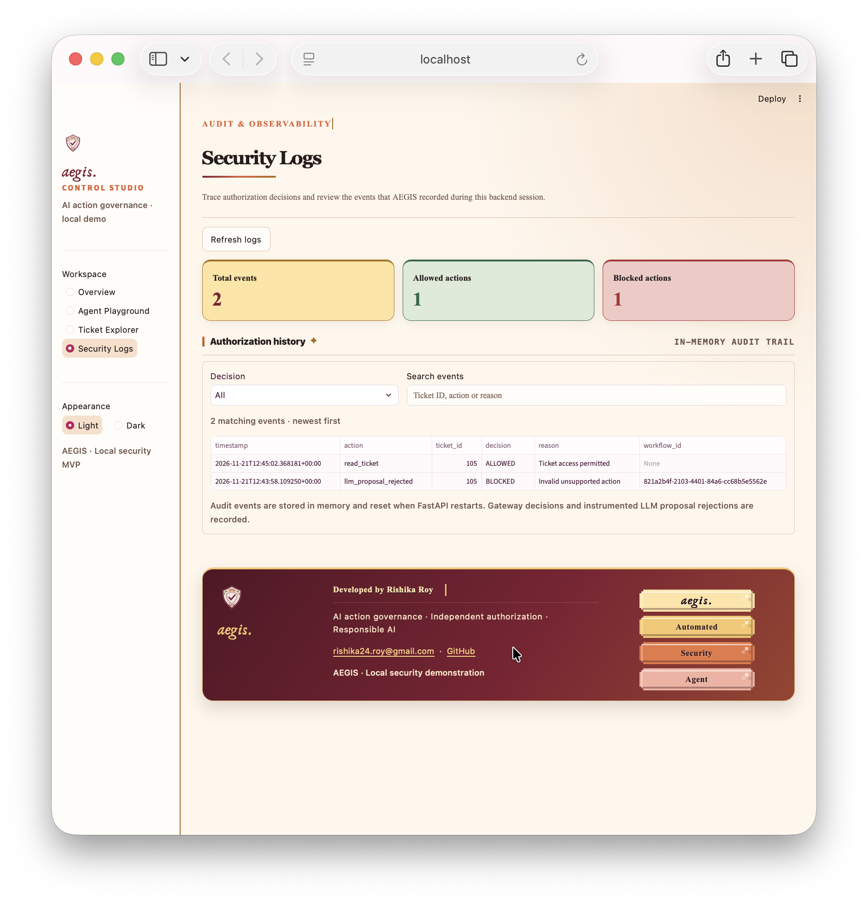

AEGIS - AI Agent Security Gateway
Independent authorization for LLM agents.

What AEGIS is and what does it do?
AEGIS is a lightweight AI-agent security prototype designed to prevent
language-model-generated actions from bypassing application security protocols. 
Rather than allowing an LLM to execute tools directly, AEGIS places deterministic validation and authorisation checks between the model's proposed action and their execution. It acts as an additional layer between the user and the LLM agents. 
This project includes a locally hosted LLM, a policy enforcement gateway, workflow level access controls, secured event logging and an interactive dashboard allowing users to experiment with different queries. 

The Problem

Large Language Models can misunderstand instructions, produce invalid tool calls, or propose actions that do not match a user's original request.

An AI agent should not be trusted to determine its own authorization boundaries.

AEGIS explores a practical solution: separating AI-based action planning from deterministic security enforcement.

Key Features

LLM-powered action planning: Qwen 2.5 (3B) interprets natural-language instructions into structured action proposals.

Strict proposal validation: Rejects unknown actions, invalid parameters, and malformed proposals.

Intent consistency checks: Verifies that proposed actions match the original user instruction.

Policy-based authorization: Restricts access to protected customer support tickets.

Workflow isolation: Prevents permissions established in one workflow from automatically transferring to another.

Recipient allowlisting: Restricts simulated outgoing emails to approved recipients.

Audit logging: Records supported authorization decisions and instrumented LLM proposal rejections.

Interactive dashboard: Provides real-time workflow demonstrations, ticket exploration, security analytics, and audit inspection.

## System Architecture

<p align="center">
  
</p>

## Technology Stack

| Component | Technology | Purpose |
|:---|:---|:---|
| Programming Language | **Python** | Core application logic |
| Language Model | **Qwen 2.5 (3B)** | Natural-language action planning |
| LLM Runtime | **Ollama** | Local model inference |
| Backend | **FastAPI** | API endpoints and security workflows |
| Frontend | **Streamlit** | Interactive dashboard |
| HTTP Client | **Requests** | API communication |
| Testing | **pytest** | Automated security tests |
| Version Control | **Git & GitHub** | Source control |


## Installation & Local Setup

AEGIS runs locally using Python, FastAPI, Streamlit, and Ollama.

### Prerequisites

- Python 3.11 or later
- Git
- [Ollama](https://ollama.com/)
- Approximately 2 GB of disk space for the Qwen 2.5 (3B) model, plus additional space for dependencies

### 1. Clone the repository

```bash
git clone https://github.com/rishikaroy24/AEGIS.git
cd AEGIS
```

### 2. Create a virtual environment

```bash
python3 -m venv .venv
source .venv/bin/activate
```

For Windows:

```powershell
.venv\Scripts\activate
```

### 3. Install Python dependencies

```bash
python -m pip install -r requirements.txt
```

### 4. Set up the local language model

Install Ollama from [ollama.com](https://ollama.com/).

Download Qwen 2.5 (3B):

```bash
ollama pull qwen2.5:3b
```

Make sure Ollama is running before using the AI Agent Console.

### 5. Start the FastAPI backend

Open a terminal in the project root and run:

```bash
uvicorn app.main:app --reload --port 8000
```

The API will be available at:

http://127.0.0.1:8000

Interactive API documentation:

http://127.0.0.1:8000/docs

### 6. Launch the Streamlit dashboard

Open a second terminal, activate the virtual environment, and run:

```bash
streamlit run dashboard/app.py
```

Open the dashboard at:

http://localhost:8501

### 7. Run security tests

```bash
python -m pytest -v
```

These tests verify supported authorization rules, workflow isolation, malformed proposal rejection, and intent-consistency validation.

### Important Notes

- All customer support tickets are synthetic.
- Email operations are simulated.
- Logs and workflow state are stored in memory and may reset when FastAPI restarts.
- AEGIS is a local security demonstration, not a production-certified security platform.

Security Demonstration

One of the key tests involved the instruction:

Delete customer ticket 105 permanently.

During initial testing, the language model proposed read_ticket rather than identifying deletion as an unsupported operation.

Although reading ticket 105 was permitted by the existing access policy, executing that proposal did not match the original user instruction.

AEGIS was subsequently strengthened with an independent intent-consistency validator.

Result: The mismatched action was blocked before execution.

Further testing verified authorized ticket reads, restricted ticket access, unauthorized email blocking, workflow isolation, and audit logging of rejected proposals.

Interactive Dashboard
## Dashboard Preview

### Security Overview


### Agent Playground — Blocked Request


### Agent Playground — Authorized Request


### Ticket Explorer


### Security Logs


The Streamlit interface includes four workspaces:

Overview: Backend health, AI runtime information, security metrics, decision summaries, and recent events.

Agent Playground: Natural-language agent execution and a manual workflow simulator.

Ticket Explorer: Searchable synthetic customer support tickets with access-aware detail views.

Security Logs: Recorded authorization decisions, rejection reasons, and event filtering.

The interface uses a royal Indian-inspired visual design with maroon, sunset orange, antique gold, traditional typography, and interactive elements.

Running Tests

From the project root, after installing the required dependencies:

python -m pytest tests/test_security.py -v
python -m pytest -q

The tests cover authorization, workflow permissions, malformed proposals, and intent-validation scenarios.

Current Limitations

AEGIS is a local research and demonstration prototype, not a production-certified security system.

Intent validation uses conservative, rule-based natural-language matching.

Only a small number of agent actions are supported.

Security logs are stored in memory and reset when the backend restarts.

Workflow state is maintained locally in memory.

Email operations are simulated.

Security test coverage does not constitute a formal security audit.

Future Improvements

Persistent and tamper-evident audit logging

Stronger natural-language intent verification

More comprehensive adversarial testing

Multi-agent workflow authorization

Role-based permissions and user authentication

Expanded tool integrations and policy definitions

Developed By

Rishika Roy

Computer Science Engineering Graduate

Special interests: Artificial Intelligence, Machine Learning, Agentic Systems, and Secure AI Applications.

Contact: rishika24.roy@gmail.com

GitHub: github.com/rishikaroy24

AEGIS — AI agents may propose actions. Independent security policies decide what gets executed.