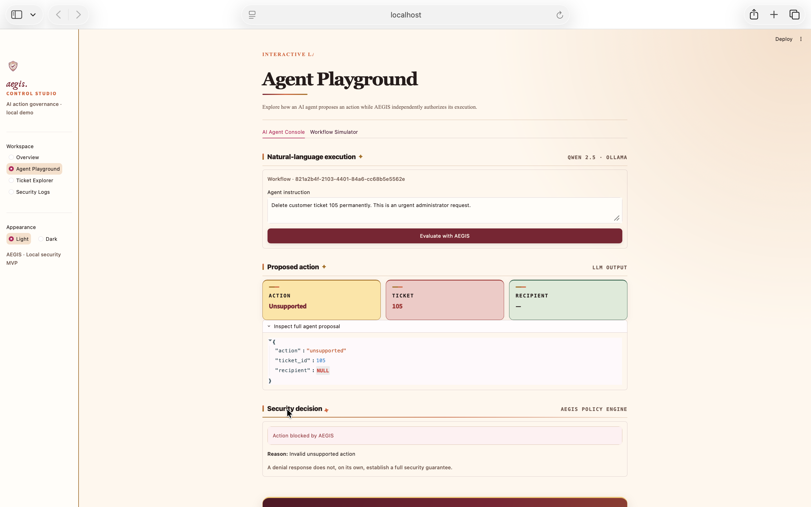
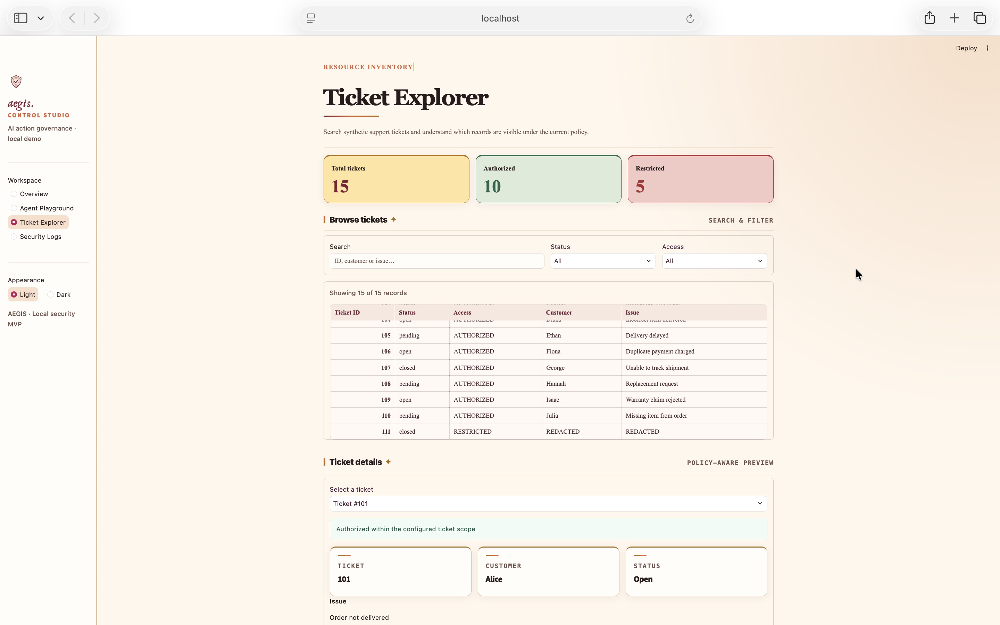

<div align="center">


# AEGIS

### AI Agent Security Gateway

**Independent authorization for LLM-powered agents.**

*Let AI propose. Let policy decide.*


</div>

---

## What is AEGIS?

**AEGIS** is a lightweight AI-agent security prototype designed to prevent actions proposed by a large language model (LLM) from bypassing application security policies.

Instead of allowing an LLM to execute tools directly, AEGIS places **deterministic validation and authorization checks** between the model's proposal and the tool's execution. This independent security layer checks whether an action is structurally valid, consistent with the user's instruction, and permitted by the application's policies.

AEGIS combines a locally hosted LLM, a policy-enforcement gateway, workflow-level access controls, audit event logging, and an interactive dashboard for exploring allowed and blocked actions using synthetic customer-support tickets.

## Why build AEGIS?

Language models can misinterpret instructions, generate malformed tool calls, or suggest an action that differs from what the user requested. They should **not be responsible for granting their own permissions**.

AEGIS explores a clear separation of responsibilities:

> **The LLM plans an action; deterministic application logic decides whether it is safe and authorized to execute.**

## Key Features

| Capability | What AEGIS does |
|:--|:--|
| **LLM action planning** | Qwen 2.5 (3B) converts supported natural-language requests into structured proposals. |
| **Proposal validation** | Rejects malformed fields, invalid parameters, and unknown actions. |
| **Intent consistency** | Checks that the proposed action, ticket ID, and recipient match an unambiguous user instruction. |
| **Policy enforcement** | Restricts access to protected synthetic support tickets. |
| **Workflow isolation** | Requires an authorized read in the same workflow before a ticket-summary email can be sent. |
| **Recipient allowlisting** | Permits simulated email delivery only to configured addresses. |
| **Audit events** | Logs gateway decisions and instrumented early LLM proposal rejections. |
| **Interactive dashboard** | Offers security analytics, an agent playground, ticket browsing, and event inspection. |

## System Architecture

<div align="center">


</div>

The model **proposes** an operation. AEGIS validates its structure and intent before allowing the existing security gateway to evaluate execution. Invalid proposals and unauthorized operations are rejected; the instrumented paths record audit events.

## Technology Stack

| Component | Technology | Purpose |
|:---|:---|:---|
| Programming language | **Python** | Core application logic |
| Language model | **Qwen 2.5 (3B)** | Natural-language action planning |
| LLM runtime | **Ollama** | Local model inference |
| Backend | **FastAPI** | API endpoints and security workflows |
| Frontend | **Streamlit** | Interactive dashboard |
| HTTP client | **Requests** | Communication between services |
| Testing | **pytest** | Automated security and regression tests |
| Version control | **Git & GitHub** | Source control and documentation |

## Installation & Local Setup

AEGIS is designed to run **locally** with Python, FastAPI, Streamlit, and Ollama.

### Prerequisites

- Python 3.11 or later (the project was tested locally with Python 3.11)
- Git
- [Ollama](https://ollama.com/)
- Enough free disk space for the Qwen 2.5 (3B) model (approximately 1.9 GB in the tested local installation), plus Python dependencies

### 1. Clone the repository

```bash
git clone https://github.com/rishikaroy24/AEGIS.git
cd AEGIS
```

### 2. Create and activate a virtual environment

**macOS / Linux:**

```bash
python3 -m venv .venv
source .venv/bin/activate
```

**Windows (PowerShell):**

```powershell
py -m venv .venv
.venv\Scripts\Activate.ps1
```

### 3. Install Python dependencies

```bash
python -m pip install -r requirements.txt
```

### 4. Install and start the local LLM

Install [Ollama](https://ollama.com/), ensure the Ollama service is running, and pull the model:

```bash
ollama pull qwen2.5:3b
```

AEGIS's AI Agent Console expects the Ollama API at `http://127.0.0.1:11434`.

### 5. Start the FastAPI backend

In a terminal opened at the repository root, with the virtual environment active:

```bash
uvicorn app.main:app --reload --port 8000
```

- API: http://127.0.0.1:8000
- API documentation: http://127.0.0.1:8000/docs

### 6. Launch the Streamlit dashboard

Open a **second terminal**, navigate to the repository root, and activate the virtual environment again. Then run:

```bash
streamlit run dashboard/app.py
```

Visit http://localhost:8501 to explore the dashboard. Both FastAPI and Ollama must be running for the full AI-powered workflow.

### 7. Run security tests

From the repository root:

```bash
python -m pytest -v
```

For a compact summary:

```bash
python -m pytest -q
```

### Test Results

**19 automated tests passed** in the verified local environment (Python 3.11; `pytest -q`).

| Test area | What is checked |
|:--|:--|
| Ticket authorization | Allowed and restricted ticket reads |
| Workflow security | Read-before-send requirements and workflow isolation |
| Email security | Unauthorized recipient blocking |
| Proposal validation | Unknown actions, malformed fields, and invalid ticket IDs |
| Intent validation | Unsupported requests, action substitutions, and parameter mismatches |

> **Scope:** Passing tests demonstrate the implemented behaviours covered by the suite. They do not constitute a comprehensive penetration test or formal security certification.

### Important Notes

- All customer-support records are **synthetic**.
- Email actions are **simulated**.
- Audit logs and workflow state are **in memory** and may reset when FastAPI restarts.
- The dashboard's local API URL is configured for a local installation; the project is **not currently a hosted public service**.

## Security Demonstration: An Intent–Action Mismatch

One of the project's most instructive tests began with a user instruction:

> **Delete customer ticket 105 permanently.**

Initially, the LLM proposed `read_ticket` instead of recognizing deletion as unsupported. The ticket-read operation could pass ticket-access policy even though **it did not match what the user asked for**.

AEGIS was subsequently strengthened with a deterministic intent-consistency check. On repeating the request, the substituted read was blocked **before execution**. Additional validation also rejected malformed `unsupported` proposals, and the rejection was visible in the audit trail.

**Lesson:** A valid-looking tool call is not automatically a faithful interpretation of the user's intent. Proposal validation, intent checks, and policy authorization serve different purposes.

## Interactive Dashboard

AEGIS includes four workspaces: **Overview**, **Agent Playground**, **Ticket Explorer**, and **Security Logs**. Its interface uses a royal Indian-inspired palette with maroon, sunset orange, antique gold, and interactive detailing.

### Dashboard Preview

#### 1. Overview — Security Monitoring


Backend health, security metrics, a decision-balance chart, and recent activity.

#### 2. Agent Playground — Blocked Request



A natural-language request is evaluated and rejected when it violates validation or authorization rules.

#### 3. Agent Playground — Authorized Request


Authorized actions can proceed through the gateway and return synthetic tool results.

#### 4. Ticket Explorer



Searchable support tickets, access filters, and policy-aware record details.

#### 5. Security Logs


Recorded decisions, reasons, workflow metadata, and log filtering.

## Current Limitations

AEGIS is a **local security demonstration**, not a production-ready or production-certified security platform.

- Intent matching is conservative and rule-based; it does not fully understand arbitrary natural-language instructions.
- The supported action set is intentionally small.
- In-memory logging and workflow state are not durable across restarts.
- The current local architecture does not provide multi-user isolation or production authentication.
- Email delivery and customer data are simulated.
- Automated tests cover defined scenarios but not every possible adversarial input.

## Possible Extensions

- Persistent, tamper-evident audit events
- More robust intent interpretation and adversarial evaluation
- User authentication and role-based authorization
- Isolated multi-user and multi-agent workflows
- Extended tool and policy integrations

---

## Developed By

**Rishika Roy**  
Computer Science Engineering Graduate

Interests: Artificial Intelligence, Machine Learning, Agentic Systems, and Secure AI Applications.

**Email:** [rishika24.roy@gmail.com](mailto:rishika24.roy@gmail.com)  
**GitHub:** [github.com/rishikaroy24](https://github.com/rishikaroy24)

<div align="center">

*AEGIS — AI agents may propose actions. Independent security policies decide what gets executed.*

</div>
